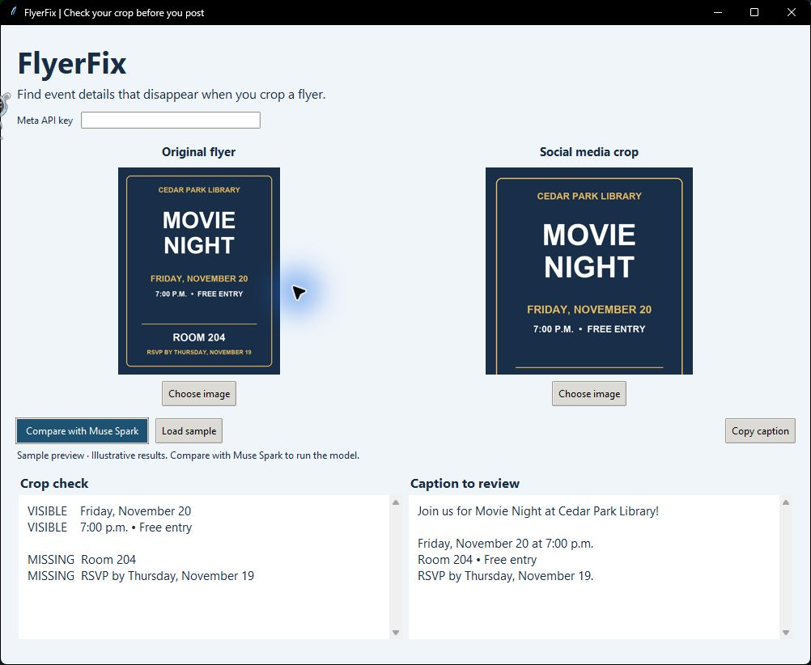

# FlyerFix

FlyerFix helps community organizers check that key event details survive a social media crop. It compares the original flyer with the version you plan to post, flags missing, changed, or hard-to-read details, and drafts a plain-text caption for review.

**Hackathon theme:** Build for Your World.

## Screenshot



The running desktop app is shown in sample preview mode with illustrative results.

## Run locally

Use Python 3.10 or later with Tkinter and a Meta Model API key with access to Muse Spark 1.3.

```powershell
python -m pip install -r requirements.txt
python flyerfix.py
```

Enter your key in the masked field or provide it through the MODEL_API_KEY environment variable. The app opens with a fictional library movie-night flyer and a square crop. Select **Compare with Muse Spark**. You can also choose your own images. Use **Copy caption** after reviewing the draft against the original.

## How it works

FlyerFix resizes large images and sends both JPEGs to the Meta Model API in one chat completion. Muse Spark reads the original and checks the corresponding event details against the crop. The app displays the comparison, suggested caption, and details to verify. Review the caption against the original before posting. Images are sent to Meta when you click Compare, and the app does not write your key to disk.

[Meta Model API vision guide](https://dev.meta.ai/docs/cookbook/vision-input)

## Three-minute demo

1. Show the full sample flyer and square crop side by side. Point out that the crop keeps the date and time while cutting off the room and RSVP deadline.
2. Run the live comparison. Check whether it distinguishes the details that survived from the ones that were lost.
3. Show how the suggested caption recovers the missing details. Explain that Muse Spark compares both images in a single request and that the organizer reviews the result before posting.

The sample flyers are fictional and included in this repository. Keep the API key entry out of the recording.
